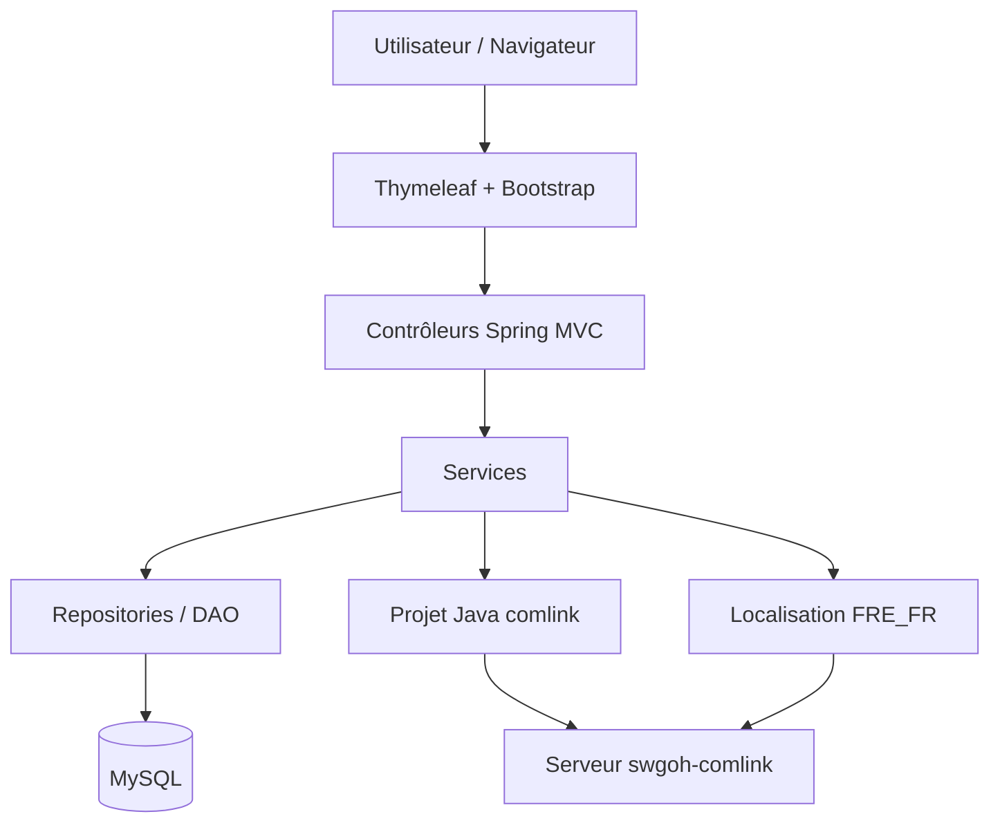
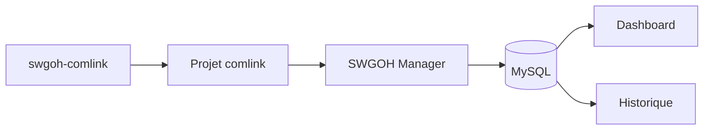
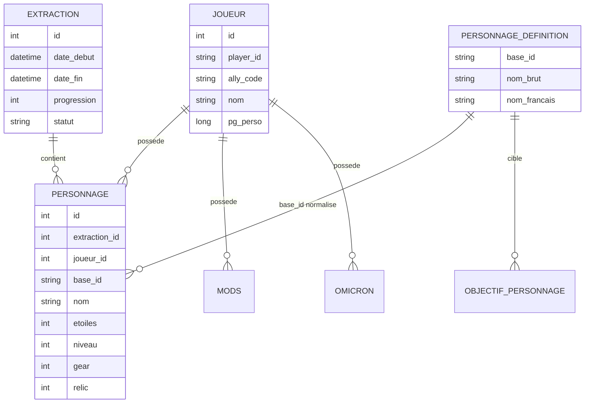

# ⚔️ SWGOH Manager

> Application web de suivi, d'analyse et de pilotage de guilde pour **Star Wars: Galaxy of Heroes**.


**SWGOH Manager** centralise les données d'une guilde SWGOH dans une interface web unique afin de suivre les joueurs, leurs rosters, leurs Omicrons, leurs mods, leur progression et les objectifs de guilde.

L'application s'appuie sur un projet Java compagnon, [`comlink`](https://github.com/Xalkinn/comlink), lui-même utilisé pour récupérer et normaliser les données provenant de **swgoh-comlink**.

---

## 📚 Sommaire

- [Pourquoi ce projet ?](#-pourquoi-ce-projet-)
- [Fonctionnalités](#-fonctionnalités)
- [Aperçu de l'application](#-aperçu-de-lapplication)
- [Architecture](#-architecture)
- [Cycle des données](#-cycle-des-données)
- [Traductions françaises](#-traductions-françaises)
- [Structure de la base de données](#-structure-de-la-base-de-données)
- [Stack technique](#-stack-technique)
- [Installation](#-installation)
- [Configuration](#-configuration)
- [Premier démarrage](#-premier-démarrage)
- [Routes principales](#-routes-principales)
- [Structure du projet](#-structure-du-projet)
- [ModQ](#-modq)
- [Captures d'écran](#-captures-décran)
- [Dépannage](#-dépannage)
- [Roadmap](#-roadmap)
- [Projet lié](#-projet-lié)

---

# 🎯 Pourquoi ce projet ?

Les informations utiles d'un joueur SWGOH sont nombreuses et souvent dispersées : roster, reliques, mods, Omicrons, puissance galactique, historique de progression, etc.

L'objectif de **SWGOH Manager** est de regrouper ces informations dans une interface pensée pour la gestion quotidienne d'une guilde.

Le projet permet notamment de répondre rapidement à des questions telles que :

- Quels joueurs ont progressé depuis la dernière extraction ?
- Qui possède déjà un personnage à la relique demandée ?
- Combien de membres ont terminé un objectif de guilde ?
- Quels Omicrons sont présents dans la guilde ?
- Quel est l'état du roster d'un joueur précis ?
- Quelle est la qualité globale de ses mods ?
- Quels personnages sont encore peu développés ?
- Quand les données ont-elles été mises à jour pour la dernière fois ?

L'application conserve également des **extractions historisées**, ce qui permet d'observer l'évolution de la guilde dans le temps.

---

# ✨ Fonctionnalités

## 📊 Dashboard de guilde

Le dashboard principal donne une vue synthétique de l'état de la guilde.

Il regroupe notamment :

- statistiques globales ;
- répartition des niveaux d'équipement ;
- nombre d'Omicrons ;
- état et fraîcheur des données ;
- dernière synchronisation ;
- actions de mise à jour ;
- état des batchs en cours ;
- progression des traitements ;
- derniers upgrades réalisés dans la guilde ;
- pagination des derniers upgrades ;
- accès direct au dashboard individuel d'un joueur.

Un sélecteur permet de choisir directement un joueur depuis le haut de la page.

---

## 👤 Dashboard individuel joueur

Chaque membre de la guilde dispose de son propre dashboard :

```text
/dashboard/joueur/{id}
```

Il permet d'obtenir une vue complète du joueur :

- nom ;
- Ally Code ;
- puissance galactique personnages ;
- date de dernière capture ;
- taille du roster ;
- nombre de personnages 7★ ;
- nombre de personnages G13 ;
- nombre de personnages reliqués ;
- répartition Gear G1 → G13 ;
- répartition des reliques ;
- liste des Omicrons ;
- statistiques détaillées sur les mods ;
- score ModQ ;
- vitesse moyenne des mods ;
- répartition des mods selon leur vitesse ;
- répartition des raretés ;
- roster complet avec recherche.

Le dashboard joueur utilise les **noms français des personnages** lorsque la traduction est disponible.

---

## 👥 Suivi joueur

La rubrique **Suivi joueur** permet d'étudier l'évolution des membres de la guilde.

Elle propose plusieurs vues selon les besoins :

- évolution récente ;
- recherche par joueur ;
- comparaison entre plusieurs extractions ;
- progression Gear ;
- progression Reliques ;
- progression étoiles.

Les extractions conservées en base permettent de comparer deux états différents d'un roster.

---

## 🎯 Objectifs de guilde

La page **Objectifs** permet de définir une cible à atteindre sur un personnage.

Exemple :

```text
Général Skywalker → Relique 7
```

Pour chaque objectif, il est possible de consulter le détail des joueurs et leur avancement.

Le comparatif affiche :

- tous les joueurs de la guilde ;
- leur niveau de relique actuel ;
- la relique cible ;
- leur progression ;
- les joueurs ayant atteint **100 %** ;
- le nombre total de joueurs ayant terminé l'objectif.

Les joueurs qui ont déjà dépassé la relique demandée sont considérés comme ayant terminé l'objectif.

---

## 🔮 Omicrons

Le module Omicrons centralise les compétences Omicron détectées pour les joueurs de la guilde.

Il permet d'afficher :

- joueur ;
- personnage ;
- type de capacité ;
- état actif / non actif.

Les Omicrons proviennent du projet `comlink`, qui enregistre désormais les **vrais `baseId` SWGOH**.  
Cela permet à SWGOH Manager de retrouver automatiquement le nom français correspondant.

---

## 🧩 Mods

Les mods récupérés sont stockés afin de produire plusieurs statistiques :

- nombre total de mods ;
- mods sans vitesse ;
- vitesse secondaire 1–14 ;
- vitesse secondaire 15–19 ;
- vitesse secondaire 20–24 ;
- vitesse secondaire 25+ ;
- vitesse moyenne ;
- rareté des mods ;
- mods normaux ;
- mods OR.

Ces données sont utilisées à la fois dans le dashboard joueur et dans le calcul du **ModQ**.

---

## ⭐ ModQ

Le ModQ est un indicateur maison permettant d'évaluer la qualité des mods d'un joueur par rapport à sa puissance galactique personnages.

Le calcul actuel est :

```text
ModQ =
(
    (0.8 × mods vitesse 15–19)
    + (1.0 × mods vitesse 20–24)
    + (1.2 × mods vitesse 25+)
)
÷ PG personnages
× 100000
```

Cet indicateur permet de comparer plus facilement des joueurs ayant des rosters de tailles différentes.

---

## 🔄 Batchs et synchronisation

Depuis le dashboard, plusieurs traitements peuvent être lancés :

### Synchronisation guilde

Met à jour les joueurs présents dans la guilde et leur état.

### Batch Roster

Met à jour les rosters des membres et crée une nouvelle extraction historisée.

### Batch Omicron

Met à jour les Omicrons à partir des données récupérées via le projet `comlink`.

### Mise à jour ModQ

Recalcule les informations nécessaires au classement ModQ.

Les principaux traitements disposent d'un **suivi de progression** directement dans l'interface.

---

## 🌙 Interface moderne et mode sombre

L'interface a été entièrement harmonisée autour d'un design commun :

- navigation moderne ;
- cartes de statistiques ;
- tableaux homogènes ;
- badges ;
- barres de progression ;
- responsive design ;
- mode clair / sombre ;
- préférence de thème conservée dans le navigateur avec `localStorage`.

Le même thème est utilisé sur l'ensemble de l'application.

---

# 🖼️ Aperçu de l'application

> Les captures ci-dessous sont volontairement stockées dans le projet afin que le README GitHub reste autonome.  
> Il suffit de remplacer les images dans `src/main/resources/image/` lorsque l'interface évolue.

---

## Dashboard de guilde


---

## Dashboard joueur


---

## Suivi joueur

### Recherche simple


### Recherche avancée


---

## Omicrons


---

## Objectifs de guilde


---

## ModQ


---

## Mode sombre


---

# 🏗️ Architecture

Le projet suit une architecture Spring MVC classique, avec une séparation entre affichage, logique métier et accès aux données.



### Responsabilités

| Couche | Rôle |
|---|---|
| `controleur` | Routes HTTP et préparation des modèles Thymeleaf |
| `service` | Logique métier, batchs, calculs et agrégation |
| `repository` | Requêtes Spring Data JDBC |
| `dao` | Requêtes SQL / JDBC historiques |
| `modele` | Entités métier |
| `dto` | Données spécifiques aux vues |
| `templates` | Pages Thymeleaf |
| `static/css` | Design |
| `static/js` | Interactions côté navigateur |
| `client` | Appels spécifiques au serveur swgoh-comlink |

---

# 🔁 Cycle des données

Le fonctionnement général est le suivant :



## Exemple : Batch Roster

1. SWGOH Manager récupère les joueurs actifs de la guilde.
2. Le projet `comlink` interroge les données SWGOH.
3. Un nouvel identifiant d'extraction est créé.
4. Les personnages de chaque joueur sont enregistrés.
5. Les anciennes extractions restent en base.
6. Les dashboards utilisent la dernière extraction.
7. Les pages de suivi peuvent comparer les extractions entre elles.

Cette approche permet de conserver un véritable historique de progression.

---

# 🇫🇷 Traductions françaises

Les données techniques SWGOH utilisent souvent des identifiants tels que :

```text
AHSOKATANO
DARTHVADER
PADAWANSABINE
```

ou dans les rosters :

```text
AHSOKATANO:SEVEN_STAR
```

SWGOH Manager conserve ces identifiants techniques mais affiche le **nom français officiel** dans l'interface.

## Fonctionnement

Le client `SwgohLocalizationClient` interroge le serveur `swgoh-comlink` :

```text
POST /metadata
```

afin de récupérer :

```text
latestLocalizationBundleVersion
```

Puis :

```text
POST /localization
```

avec le bundle :

```text
<version>:FRE_FR
```

Le fichier `Loc_FRE_FR.txt` est ensuite transformé en dictionnaire de traductions.

Les clés personnages suivent notamment le format :

```text
UNIT_<baseId>_NAME
```

Exemple :

```text
UNIT_DARTHVADER_NAME
→ Dark Vador
```

---

## Table `personnage_definition`

Les traductions sont persistées dans une table de référence dédiée :

```text
personnage_definition
```

Elle évite de dupliquer le nom français dans chaque ligne de la table `personnage`.

Exemple :

| base_id | nom_brut | nom_francais |
|---|---|---|
| `DARTHVADER` | `DARTHVADER` | Dark Vador |
| `AHSOKATANO` | `AHSOKATANO` | Ahsoka Tano |
| `PADAWANSABINE` | `PADAWANSABINE` | Sabine Wren, Padawan |

La table `personnage` conserve les données techniques originales.

Pour faire correspondre :

```text
AHSOKATANO:SEVEN_STAR
```

avec :

```text
AHSOKATANO
```

le suffixe après `:` est ignoré lors des jointures vers le référentiel.

---

## Noms ambigus

Certaines unités possèdent plusieurs versions avec un nom proche.

Des corrections d'affichage ciblées peuvent donc être ajoutées par `baseId`, par exemple :

```text
AHSOKATANO → Ahsoka Tano (Chipie)
REY        → Rey (Pilleuse)
```

Le `baseId` reste la référence technique : seul le libellé visible est adapté.

---

# 🗄️ Structure de la base de données

Les principales tables utilisées sont :

| Table | Utilité |
|---|---|
| `joueur` | Informations générales des membres |
| `personnage` | Roster des joueurs par extraction |
| `personnage_definition` | Référentiel et noms français |
| `extraction` | Historique des synchronisations de roster |
| `omicron` | Omicrons détectés |
| `mods` | Mods des joueurs |
| `objectif_personnage` | Objectifs personnages |
| `objectif` | Données historiques liées aux objectifs selon les modules |

## Relation simplifiée



> Le projet contient actuellement le script SQL spécifique à `personnage_definition`.  
> Pour une installation totalement vierge, il est recommandé de fournir à terme un `schema.sql` complet avec l'ensemble des tables métier.

---

# 🛠️ Stack technique

| Composant | Technologie |
|---|---|
| Langage | Java 21 |
| Framework | Spring Boot 4.1.0 |
| Web | Spring Web MVC |
| Accès aux données | Spring Data JDBC + JDBC |
| Templates | Thymeleaf |
| Front-end | HTML / CSS / JavaScript |
| UI | Bootstrap 5.3 |
| Icônes | Bootstrap Icons |
| Base de données | MySQL |
| Build | Maven / Maven Wrapper |
| Données SWGOH | projet `comlink` + `swgoh-comlink` |
| Localisation | bundle officiel `FRE_FR` via swgoh-comlink |

---

# 🚀 Installation

## 1. Prérequis

Avant de lancer le projet, prévoir :

- **Java 21** ;
- **MySQL** ;
- **Git** ;
- une instance fonctionnelle de **swgoh-comlink** ;
- le projet Java [`comlink`](https://github.com/Xalkinn/comlink) ;
- Maven ou le Maven Wrapper inclus dans les projets.

Configuration actuellement utilisée :

```text
SWGOH Manager : http://localhost:8081
swgoh-comlink : http://localhost:3000
MySQL         : localhost:3333
```

Ces valeurs peuvent être modifiées.

---

## 2. Installer le projet `comlink`

SWGOH Manager dépend actuellement de :

```xml
<dependency>
    <groupId>swgoh</groupId>
    <artifactId>comlink</artifactId>
    <version>0.0.1-SNAPSHOT</version>
</dependency>
```

Le projet `comlink` doit donc être disponible dans le dépôt Maven local.

```bash
git clone https://github.com/Xalkinn/comlink.git
cd comlink
./mvnw clean install
```

Sous Windows :

```powershell
mvnw.cmd clean install
```

---

## 3. Démarrer swgoh-comlink

Une instance `swgoh-comlink` doit être accessible.

Par défaut, SWGOH Manager utilise :

```text
http://localhost:3000
```

Cette instance est notamment nécessaire pour :

- les données récupérées par le projet `comlink` ;
- la récupération du bundle de traduction français.

---

## 4. Préparer MySQL

Créer une base :

```sql
CREATE DATABASE swgoh
CHARACTER SET utf8mb4
COLLATE utf8mb4_0900_ai_ci;
```

> Si votre installation MySQL utilise une autre collation, conservez une collation cohérente entre les colonnes utilisées dans les jointures.

Configurer ensuite les tables métier nécessaires au projet.

La table `personnage_definition` est gérée par le système de localisation et dispose également d'un script de référence :

```text
src/main/resources/sql/personnage_definition.sql
```

---

## 5. Cloner SWGOH Manager

```bash
git clone https://github.com/Xalkinn/swgoh-manager.git
cd swgoh-manager
```

---

# ⚙️ Configuration

La configuration principale se trouve dans :

```text
src/main/resources/application.properties
```

Exemple actuel :

```properties
spring.application.name=WebInterfaceSwgoh
server.port=8081

spring.datasource.url=jdbc:mysql://localhost:3333/swgoh?useSSL=false&allowPublicKeyRetrieval=true&serverTimezone=Europe/Paris
spring.datasource.username=root
spring.datasource.password=root
spring.datasource.driver-class-name=com.mysql.cj.jdbc.Driver

spring.jackson.time-zone=Europe/Paris
spring.datasource.hikari.data-source-properties.serverTimezone=Europe/Paris

swgoh.comlink.base-url=http://localhost:3000
```

Adaptez :

- le port MySQL ;
- le nom de la base ;
- l'utilisateur ;
- le mot de passe ;
- le port de l'application ;
- l'URL du serveur swgoh-comlink.

> Pour un dépôt public ou un environnement de production, ne stockez pas de mot de passe réel directement dans `application.properties`. Utilisez des variables d'environnement ou un fichier de configuration externe.

---

# ▶️ Premier démarrage

Lancer l'application :

```bash
./mvnw spring-boot:run
```

Sous Windows :

```powershell
mvnw.cmd spring-boot:run
```

Puis ouvrir :

```text
http://localhost:8081
```

## Ordre conseillé lors d'une première utilisation

1. Vérifier que MySQL est démarré.
2. Vérifier que `swgoh-comlink` répond sur le port configuré.
3. Vérifier que la dépendance Java `comlink` est installée.
4. Démarrer SWGOH Manager.
5. Lancer la **synchronisation guilde**.
6. Lancer un **Batch Roster**.
7. Lancer le **Batch Omicron**.
8. Mettre à jour les mods / ModQ selon le besoin.
9. Vérifier les dashboards.

---

# 🧭 Routes principales

| Route | Fonction |
|---|---|
| `/` | Dashboard général |
| `/dashboard/joueur/{joueurId}` | Dashboard individuel |
| `/joueurs` | Suivi joueur |
| `/objectifs` | Objectifs de guilde |
| `/omicrons` | Liste des Omicrons |
| `/modq` | ModQ / statistiques mods |
| `/analyse` | Analyse de candidat — interface préparée |
| `/actions/synchronisation-guilde` | Synchronisation guilde |
| `/actions/batch-roster` | Mise à jour des rosters |
| `/actions/batch-omicron` | Mise à jour des Omicrons |
| `/actions/maj-modq` | Mise à jour ModQ |

Des routes `/api/.../status` sont également utilisées par le JavaScript afin de suivre l'avancement des batchs.

---

# 📁 Structure du projet

```text
swgoh-manager/
│
├── pom.xml
├── mvnw
├── mvnw.cmd
├── README.md
│
└── src/
    └── main/
        ├── java/
        │   └── fr/xalkinn/swgohmanager/
        │       │
        │       ├── client/
        │       │   └── SwgohLocalizationClient.java
        │       │
        │       ├── controleur/
        │       │   ├── DashboardControleur.java
        │       │   ├── JoueurDashboardControleur.java
        │       │   ├── JoueurControleur.java
        │       │   ├── ObjectifControleur.java
        │       │   ├── OmicronControleur.java
        │       │   └── ...
        │       │
        │       ├── service/
        │       │   ├── DashboardService.java
        │       │   ├── JoueurDashboardService.java
        │       │   ├── BatchRosterService.java
        │       │   ├── BatchOmicronService.java
        │       │   ├── LocalizationService.java
        │       │   ├── PersonnageDefinitionService.java
        │       │   └── ...
        │       │
        │       ├── repository/
        │       ├── dao/
        │       ├── modele/
        │       └── dto/
        │
        └── resources/
            ├── application.properties
            │
            ├── templates/
            │   ├── dashboard.html
            │   ├── dashboard-joueur.html
            │   ├── joueurs.html
            │   ├── objectifs.html
            │   ├── omicrons.html
            │   ├── modq.html
            │   └── fragments/
            │       ├── head.html
            │       ├── menu.html
            │       └── footer.html
            │
            ├── static/
            │   ├── css/
            │   └── js/
            │
            ├── image/
            │
            └── sql/
                └── personnage_definition.sql
```

---

# 🔍 Quelques choix techniques importants

## Les données brutes restent intactes

Le projet évite volontairement de remplacer les identifiants SWGOH par les noms français dans les tables historiques.

Exemple :

```text
base_id = AHSOKATANO:SEVEN_STAR
```

reste stocké tel quel.

Le nom français est géré via le référentiel `personnage_definition`.

Cela évite de casser :

- les jointures ;
- les objectifs existants ;
- les historiques ;
- les comparaisons ;
- les imports futurs.

---

## Les Omicrons utilisent les vrais `baseId`

Le projet `comlink` doit enregistrer dans la table Omicron l'identifiant SWGOH réel :

```text
PADAWANSABINE
```

et non un libellé d'affichage tel que :

```text
PADAWAN SABINE
```

SWGOH Manager peut ensuite utiliser :

```text
PADAWANSABINE
→ personnage_definition
→ nom français
```

Cette séparation entre **identifiant technique** et **libellé d'affichage** est volontaire.

---

## Historisation par extraction

La table `personnage` n'est pas uniquement un état courant du roster.

Elle contient plusieurs générations de données associées à :

```text
extraction_id
```

Cela permet à l'application de calculer les différences entre deux périodes sans avoir besoin d'un système de journalisation externe.

---

# 🧪 Dépannage

## La dépendance `swgoh:comlink` est introuvable

Erreur Maven typique :

```text
Could not find artifact swgoh:comlink:jar:0.0.1-SNAPSHOT
```

Réinstaller le projet `comlink` :

```bash
cd comlink
./mvnw clean install
```

---

## Les traductions françaises ne se chargent pas

Vérifier que :

```text
http://localhost:3000
```

correspond bien à votre serveur swgoh-comlink.

Vérifier également :

```properties
swgoh.comlink.base-url=http://localhost:3000
```

Si aucune traduction n'est disponible, l'application conserve normalement le nom brut comme fallback.

---

## Un nom de personnage reste brut

Contrôler :

```sql
SELECT
    base_id,
    nom_brut,
    nom_francais,
    cle_localisation
FROM personnage_definition
WHERE base_id = 'BASE_ID_DU_PERSONNAGE';
```

Vérifier ensuite que le `base_id` utilisé par la donnée source correspond bien au référentiel.

---

## `Illegal mix of collations`

Exemple :

```text
Illegal mix of collations
(utf8mb4_unicode_ci,IMPLICIT)
and
(utf8mb4_0900_ai_ci,IMPLICIT)
```

Les colonnes participant à une jointure doivent utiliser des collations compatibles.

Le service `PersonnageDefinitionService` contient une logique d'alignement pour `personnage_definition`, mais il reste recommandé de garder une configuration cohérente à l'échelle de la base.

---

## Les Omicrons ne sont pas traduits

Vérifier que la colonne `omicron.personnage` contient le vrai `baseId` SWGOH.

Exemple correct :

```text
BOSSNASS
CALKESTIS
PADAWANSABINE
```

et non :

```text
BOSS NASS
CAL KESTIS OG
PADAWAN SABINE
```

---

# 🗺️ Roadmap

## ✅ Implémenté

- [x] Dashboard général moderne
- [x] Dashboard individuel par joueur
- [x] Sélecteur de joueur dans le dashboard
- [x] Suivi joueur
- [x] Historique des extractions
- [x] Comparaison entre extractions
- [x] Derniers upgrades de guilde
- [x] Suivi des objectifs
- [x] Affichage des joueurs ayant terminé un objectif
- [x] Liste des Omicrons
- [x] Statistiques de mods
- [x] ModQ
- [x] Traductions françaises des personnages
- [x] Référentiel `personnage_definition`
- [x] Gestion de certains noms ambigus
- [x] Mode sombre
- [x] Design harmonisé sur les principales pages
- [x] Menu responsive modernisé
- [x] Suivi visuel des batchs

## 🚧 À poursuivre

- [ ] Finaliser la page d'analyse de candidat par Ally Code
- [ ] Ajouter les portraits des personnages
- [ ] Ajouter des filtres avancés au roster joueur
- [ ] Ajouter davantage de graphiques historiques
- [ ] Ajouter une comparaison joueur ↔ moyenne de guilde
- [ ] Finaliser l'export CSV
- [ ] Ajouter un `schema.sql` complet
- [ ] Ajouter des tests automatisés
- [ ] Ajouter une authentification / gestion des droits
- [ ] Étudier une gestion multi-guildes

---

# 🔗 Projet lié

## `comlink`

Repository :

```text
https://github.com/Xalkinn/comlink
```

Le projet `comlink` est le composant Java chargé de dialoguer avec les données SWGOH et d'alimenter SWGOH Manager.

Il est notamment utilisé pour :

- récupération des guildes ;
- récupération des joueurs ;
- récupération des rosters ;
- gestion des reliques ;
- extraction des Omicrons ;
- récupération des données nécessaires aux imports.

SWGOH Manager se concentre ensuite sur :

- la persistance ;
- l'historisation ;
- l'analyse ;
- les statistiques ;
- la restitution web.

---

# 🤝 Contribution

Le projet est actuellement développé principalement comme outil de gestion de guilde.

Pour proposer une évolution :

1. créer une branche ;
2. développer la fonctionnalité ;
3. tester les batchs et les pages concernées ;
4. vérifier le rendu en mode clair et sombre ;
5. ouvrir une Pull Request.

Convention recommandée :

```text
feature/nom-fonctionnalite
fix/nom-correction
refactor/nom-refactor
```

---

# ⚠️ Avertissement

Ce projet est un outil communautaire non officiel.

Il n'est pas affilié à Electronic Arts, Capital Games, Lucasfilm ou Disney.

Les noms et éléments relatifs à *Star Wars: Galaxy of Heroes* appartiennent à leurs propriétaires respectifs.

---

# 📝 Licence

Aucune licence spécifique n'est actuellement déclarée dans le projet.

Si le dépôt devient public ou accueille des contributions externes, il est recommandé d'ajouter explicitement un fichier `LICENSE`.
