# ⚔️ SWGOH Manager

> Application web de suivi, d'analyse et de pilotage de guilde pour **Star Wars: Galaxy of Heroes**.


**SWGOH Manager** centralise les données d'une guilde SWGOH dans une interface web unique afin de suivre les joueurs, leurs rosters, leurs Omicrons, leurs mods, leur progression et les performances collectives en **Batailles de territoire** et **Guerres de territoire**.

L'application s'appuie à la fois sur :

- une instance **swgoh-comlink** pour les données `/player`, `/guild`, Game Data et localisation ;
- le projet Java compagnon [`comlink`](https://github.com/Xalkinn/comlink) pour certains traitements historiques de synchronisation et d'import de roster.

> **Architecture actuelle : une installation = une guilde active.**  
> La guilde est détectée au premier démarrage à partir de l'Ally Code d'un de ses membres.

---

## 📚 Sommaire

- [Pourquoi ce projet ?](#-pourquoi-ce-projet-)
- [Fonctionnalités](#-fonctionnalités)
  - [Dashboard de guilde](#-dashboard-de-guilde)
  - [Dashboard joueur](#-dashboard-individuel-joueur)
  - [Suivi joueur](#-suivi-joueur)
  - [Objectifs](#-objectifs-de-guilde)
  - [Omicrons](#-omicrons)
  - [Mods et ModQ](#-mods-et-modq)
  - [Analyse de candidat](#-analyse-de-candidat)
  - [Batailles de territoire](#-batailles-de-territoire)
  - [Guerres de territoire](#-guerres-de-territoire)
- [Configuration d'une guilde](#-configuration-dune-guilde)
- [Architecture](#-architecture)
- [Cycle des données](#-cycle-des-données)
- [Traductions françaises](#-traductions-françaises)
- [Base de données](#-base-de-données)
- [Stack technique](#-stack-technique)
- [Installation](#-installation)
- [Configuration](#-configuration)
- [Premier démarrage](#-premier-démarrage)
- [Routes principales](#-routes-principales)
- [Structure du projet](#-structure-du-projet)
- [Captures d'écran](#-captures-décran)
- [Dépannage](#-dépannage)
- [Roadmap](#-roadmap)
- [Projet lié](#-projet-lié)

---

# 🎯 Pourquoi ce projet ?

Les informations utiles d'un joueur SWGOH sont nombreuses et souvent dispersées : roster, reliques, mods, Omicrons, puissance galactique, progression, performances TB, préparation TW, etc.

L'objectif de **SWGOH Manager** est de regrouper ces informations dans une interface pensée pour la gestion quotidienne d'une guilde et le travail des officiers.

Le projet permet notamment de répondre rapidement à des questions telles que :

- Quels joueurs ont progressé depuis la dernière extraction ?
- Qui possède déjà un personnage à la relique demandée ?
- Combien de membres ont terminé un objectif de guilde ?
- Quels Omicrons prioritaires sont encore manquants ?
- Quelle est la profondeur de roster d'un joueur ?
- Quelle est la qualité globale de ses mods ?
- Comment la guilde a-t-elle performé lors des dernières TB ?
- Combien de combats et de vagues ont été réalisés chaque jour d'une TB ?
- Quelle est la série actuelle de victoires en TW ?
- Quels joueurs doivent encore poser des Omicrons TW prioritaires ?
- Comment un candidat se situe-t-il face à la moyenne et à la médiane de la guilde ?

L'application conserve des **extractions et historiques en base**, ce qui permet d'observer l'évolution de la guilde dans le temps sans dépendre d'un outil externe.

---

# ✨ Fonctionnalités

## 📊 Dashboard de guilde

Le dashboard principal donne une vue synthétique de l'état de la guilde.

Il regroupe notamment :

- statistiques globales ;
- répartition des niveaux d'équipement ;
- nombre d'Omicrons ;
- Omicrons actifs par mode **TW / TB / Raid / Grande Arène** ;
- tuiles Omicron cliquables avec détail des possesseurs ;
- état et fraîcheur des données ;
- dernière synchronisation ;
- actions de mise à jour ;
- état des batchs en cours ;
- progression des traitements ;
- derniers upgrades réalisés dans la guilde ;
- pagination des derniers upgrades ;
- accès direct au dashboard individuel d'un joueur ;
- historique compact des dernières Batailles de territoire.

Le thème clair/sombre est commun à l'ensemble de l'application et mémorisé dans le navigateur.

---

## 👤 Dashboard individuel joueur

Chaque membre de la guilde dispose de son propre dashboard :

```text
/dashboard/joueur/{joueurId}
```

Il permet d'obtenir une vue complète du joueur :

- nom ;
- Ally Code ;
- puissance galactique personnages ;
- date de dernière capture ;
- taille du roster ;
- personnages 7★ ;
- personnages G13 ;
- personnages reliqués ;
- profondeur des reliques ;
- répartition Gear G1 → G13 ;
- liste complète des Omicrons posés ;
- progression du plan Omicron de guilde **P1 / P2 / P3 / P4** ;
- cartes P1-P4 cliquables avec la liste des Omicrons manquants ;
- statistiques détaillées sur les mods ;
- score ModQ ;
- vitesse moyenne des mods ;
- répartition des mods par vitesse et rareté ;
- roster complet avec recherche.

Les personnages sont affichés avec leur **nom français** lorsque la localisation est disponible.

---

## 👥 Suivi joueur

La rubrique **Suivi joueur** permet d'étudier l'évolution des membres de la guilde.

Elle propose notamment :

- évolution récente ;
- recherche par joueur ;
- comparaison entre plusieurs extractions ;
- progression Gear ;
- progression Reliques ;
- progression étoiles.

La table `personnage` conserve plusieurs générations de données via `extraction_id`, ce qui permet de comparer deux états d'un roster sans écraser l'historique.

---

## 🎯 Objectifs de guilde

La page **Objectifs** permet de définir une cible à atteindre sur un personnage.

Exemple :

```text
Général Skywalker → Relique 7
```

Pour chaque objectif, le comparatif affiche :

- tous les joueurs concernés ;
- leur niveau de relique actuel ;
- la relique cible ;
- leur progression ;
- les joueurs ayant atteint **100 %** ;
- le nombre total de joueurs ayant terminé l'objectif.

Un joueur ayant déjà dépassé la relique demandée reste naturellement considéré comme ayant terminé l'objectif.

---

## 🔮 Omicrons

Le module Omicrons est **dynamique** : SWGOH Manager construit son catalogue directement depuis les Game Data SWGOH.

Le fonctionnement repose sur :

```text
Game Data units
    ↓ skillReferenceList
Game Data skill
    ↓ tier.isOmicronTier + omicronMode
omicron_definition
    ↓
omicron_priorite
```

Puis les possessions des joueurs sont détectées directement dans :

```text
/player → rosterUnit[].skill[]
```

Aucun personnage Omicron n'a besoin d'être codé manuellement dans SWGOH Manager.

### Catégories gérées

La page `/omicrons` permet de gérer les priorités pour :

- **Guerre de territoires** ;
- **Bataille de territoire** ;
- **Grande Arène** ;
- **Raid** ;
- **Conquête**.

Les différents modes GAC exposés par Game Data sont regroupés sous **Grande Arène**.

### Priorités de guilde

Chaque Omicron peut recevoir une priorité :

| Priorité | Signification |
|---|---|
| **P1** | Obligatoire |
| **P2** | Très prioritaire |
| **P3** | Recommandé |
| **P4** | Secondaire |

La page permet de :

- filtrer par catégorie ;
- choisir le personnage ;
- choisir la capacité (`Chef`, `Unique`, `Spéciale`, `Basique`) ;
- ajouter, modifier ou supprimer une priorité ;
- visualiser les joueurs qui possèdent l'Omicron ;
- actualiser le catalogue Game Data ;
- actualiser les possessions des joueurs.

Les variantes techniques Game Data portant le même nom sont nettoyées lorsqu'un `baseId` réellement présent dans les rosters permet d'identifier la version jouable.

### Exports Omicron

Le plan P1-P4 peut être exporté depuis `/omicrons` en :

- **Excel `.xlsx`** ;
- **LibreOffice `.ods`** ;
- **CSV `.csv`**.

Les exports Excel et LibreOffice contiennent quatre onglets :

```text
P1
P2
P3
P4
```

Chaque onglet fournit une matrice **Joueurs × Omicrons**, avec :

- `OUI / NON` ;
- mise en forme visuelle ;
- progression `x/y` par joueur ;
- ligne `TOTAL OUI` par Omicron.

Les fichiers XLSX/ODS sont générés sans Apache POI.

---

## 🧩 Mods et ModQ

Les mods récupérés sont stockés afin de produire plusieurs statistiques :

- nombre total de mods ;
- mods sans vitesse ;
- vitesse secondaire 1–14 ;
- vitesse secondaire 15–19 ;
- vitesse secondaire 20–24 ;
- vitesse secondaire 25+ ;
- vitesse moyenne ;
- rareté des mods ;
- mods normaux ;
- mods OR.

### ⭐ ModQ

Le **ModQ** est un indicateur maison permettant d'évaluer la qualité des mods d'un joueur par rapport à sa puissance galactique personnages.

```text
ModQ =
(
    (0.8 × mods vitesse 15–19)
    + (1.0 × mods vitesse 20–24)
    + (1.2 × mods vitesse 25+)
)
÷ PG personnages
× 100000
```

Cet indicateur facilite la comparaison de joueurs ayant des rosters de tailles différentes.

---

## 🔎 Analyse de candidat

La page `/analyse` permet d'étudier ponctuellement un candidat à partir de son **Ally Code**, sans l'ajouter à la guilde ni enregistrer son roster dans les tables métier.

```text
Ally Code
   ↓
/player
   ↓
Analyse en mémoire
   ├── profil / PG
   ├── roster / reliques
   ├── mods / ModQ
   ├── comparaison guilde
   ├── plan Omicron P1-P4
   └── performances TB de sa guilde actuelle
```

L'analyse affiche notamment :

- PG totale, personnages et vaisseaux ;
- niveau ;
- informations GAC disponibles ;
- rangs d'arène personnages et flotte ;
- nombre de personnages, 7★, G13 et reliqués ;
- profondeur **R5+ / R7+ / R8+ / R9+ / R10** ;
- volume et vitesse des mods ;
- score ModQ ;
- comparaison à la **moyenne** et à la **médiane** de la guilde ;
- progression sur les priorités Omicron **P1 à P4** ;
- popin listant les Omicrons manquants par priorité ;
- roster complet avec recherche et noms français.

### Performances TB du candidat

Lorsque le candidat appartient à une guilde, SWGOH Manager utilise son `guildId` pour lire les résultats disponibles dans `recentTerritoryBattleResult`.

Le candidat peut ainsi être analysé sur :

- combats tentés ;
- vagues gagnées ;
- ratio vagues/combat ;
- missions spéciales tentées et réussies ;
- puissance déployée ;
- unités données ;
- détail par phase disponible.

Le récapitulatif des missions spéciales est cliquable et affiche chaque mission :

```text
✅ Réussie
❌ Échec
```

avec sa phase, sa zone et son numéro lorsque ces informations sont présentes dans le `mapStatId`.

> Le candidat reste entièrement **en mémoire**. Son roster, ses Omicrons et les données TB de sa guilde ne sont pas enregistrés dans les tables de la guilde configurée.

---

## 🌐 Batailles de territoire

Le module **Batailles de territoire** historise les résultats finaux disponibles dans :

```text
/guild → recentTerritoryBattleResult
```

Chaque TB possède un `instance_id` unique, ce qui permet de relancer l'import sans créer de doublons.

Les données sont conservées sur trois niveaux :

```text
territory_battle
    ↓
tb_activite
    ↓
tb_score_joueur
```

Les `mapStatId` bruts sont conservés afin de pouvoir produire de nouvelles analyses plus tard sans réimporter les anciennes TB.

### Jours / rounds

La page `/tb` distingue désormais la **journée réelle** de la **phase/planète Game Data**.

La vue principale utilise les compteurs Comlink :

```text
strike_attempt_round_X
strike_encounter_round_X
covert_attempt_round_X
power_round_X
unit_donated_round_X
```

Elle affiche pour **J1 → J6** :

- combats tentés ;
- vagues gagnées ;
- moyenne vagues/combat ;
- missions spéciales tentées ;
- puissance déployée ;
- unités données.

Chaque jour est cliquable et ouvre le détail joueur par joueur.

Cette approche reste correcte même lorsqu'une guilde décide de rester plusieurs jours sur la même planète.

### Planètes

Les données par planète sont affichées séparément comme **cumul sur l'ensemble de la TB**.

La vue permet de consulter :

- les planètes/zones d'une phase ;
- combats classiques tentés ;
- vagues gagnées ;
- ratio vagues/combat ;
- détail par joueur.

Les **missions spéciales sont exclues** de cette vue afin de ne pas fausser les combats classiques.

> Comlink ne fournit pas dans le résultat final un croisement fiable `round + planète`. SWGOH Manager ne tente donc pas d'inventer cette répartition.

### Missions spéciales

Pour chaque mission spéciale, le module peut distinguer :

- tentée ;
- réussie ;
- échec ;
- non tentée.

La population de référence d'une TB est volontairement :

```text
joueurs présents dans tb_score_joueur pour cette TB
∩
joueur.dans_guilde = 1
```

Ainsi :

- un membre actuel qui n'a pas participé à cette TB n'est pas ajouté artificiellement avec des zéros ;
- un ancien membre ayant quitté la guilde n'est pas affiché dans les statistiques actuelles ;
- les données historiques brutes restent néanmoins conservées.

---

## 🛡️ Guerres de territoire

Le module **Guerres de territoire** historise les résultats finaux présents dans :

```text
/guild → recentTerritoryWarResult
```

Il est volontairement conçu en **post-événement** : aucune surveillance continue de la guerre n'est nécessaire.

Une synchronisation après la TW suffit pour enregistrer les résultats récents exposés par Comlink.

### Historique TW

La page `/tw` fournit :

- victoires / défaites / égalités ;
- winrate ;
- score moyen ;
- score adverse moyen ;
- écart moyen ;
- série actuelle ;
- match le plus serré ;
- plus grosse victoire ;
- plus grosse défaite ;
- adversaire au plus gros PG ;
- graphique des scores ;
- historique des matchs ;
- popin de détail au clic sur une TW.

Comlink ne fournit pas d'`instanceId` dédié pour les résultats TW terminés. SWGOH Manager construit donc une clé d'événement stable à partir de la guilde, du type de TW et de son horaire de démarrage.

### Plan Omicron TW & profondeur de roster

La même page propose une vue de préparation de la guilde avec :

- progression du plan Omicron TW **P1 / P2 / P3 / P4** ;
- profondeur **R8+ / R9+ / R10** ;
- nombre de mods 25+ ;
- ModQ ;
- tri prioritaire des joueurs ayant des P1/P2 manquantes.

Les tuiles suivantes sont cliquables :

- **Plan TW global** ;
- **P1 complètes** ;
- **P2 complètes**.

La popin affiche :

- nombre de joueurs concernés ;
- nombre réel d'Omicrons manquants ;
- joueur ;
- personnage ;
- capacité concernée.

Exemple : si 10 joueurs sont incomplets mais que l'un d'eux manque 3 Omicrons, la popin distingue correctement :

```text
10 joueurs concernés
12 Omicrons manquants
```

### Limitation volontaire

Les résultats finaux actuellement exposés par Comlink ne contiennent pas les détails individuels tels que :

- attaques réalisées ;
- victoires/défaites offensives ;
- bannières ;
- défenses posées ;
- défenses tenues.

SWGOH Manager ne tente donc pas d'extrapoler ces données.

La prochaine évolution prévue est l'**analyse d'adversaire** à partir de `territoryWarStatus` lorsqu'une TW est active.

---

## 🔄 Batchs et synchronisation

Depuis le dashboard, plusieurs traitements peuvent être lancés.

### Synchronisation guilde

Met à jour les joueurs présents dans la guilde et leur état `dans_guilde`.

La synchronisation tente également d'historiser les résultats TB/TW récemment disponibles.

### Batch Roster

Met à jour les rosters des membres et crée une nouvelle extraction historisée.

### Batch Omicron

Vérifie la version Game Data, actualise le catalogue Omicron si nécessaire puis analyse les skills du roster de chaque membre.

### Mise à jour Mods / ModQ

Met à jour les données nécessaires aux statistiques de mods et au calcul ModQ.

Les traitements principaux disposent d'un suivi de progression dans l'interface.

---

## 🌙 Interface moderne et mode sombre

L'interface utilise un design commun sur les principales pages :

- navigation responsive ;
- cartes de statistiques ;
- tableaux homogènes ;
- badges ;
- barres de progression ;
- popins Bootstrap ;
- responsive design ;
- mode clair / sombre ;
- préférence conservée via `localStorage`.

---

# ⚙️ Configuration d'une guilde

SWGOH Manager fonctionne actuellement avec **une seule guilde active par installation**.

Au premier démarrage, toutes les pages sont redirigées vers :

```text
/setup
```

Le formulaire demande simplement l'**Ally Code d'un membre de la guilde**.

Le flux est :

```text
Ally Code
   ↓
/player
   ↓
guildId du joueur
   ↓
/guild
   ↓
Nom + ID de la guilde
   ↓
table guilde
```

La guilde active est persistée en base dans :

```text
guilde
```

Elle peut être reconfigurée depuis l'administration / le setup.

La page `/admin` affiche notamment :

- guilde active ;
- état système ;
- état de la base ;
- URL swgoh-comlink ;
- test de connexion Comlink ;
- compteurs des principales tables ;
- paramètres d'environnement non sensibles.

---

# 🖼️ Captures d'écran

> Les captures sont stockées dans `src/main/resources/image/` afin que le README GitHub reste autonome.

## Dashboard de guilde

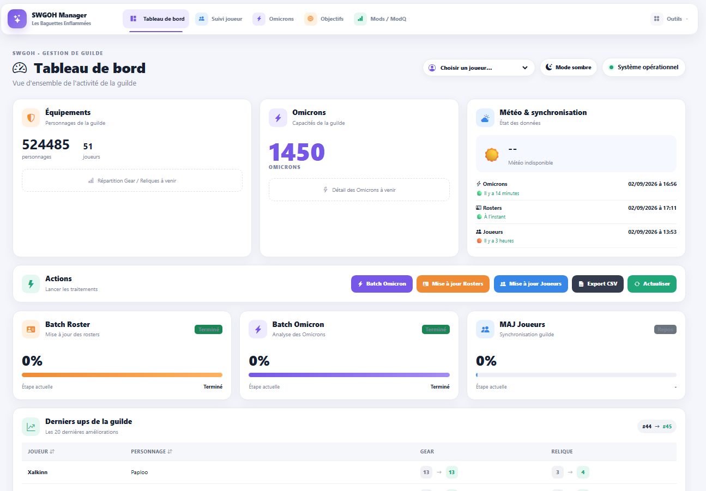

## Dashboard joueur

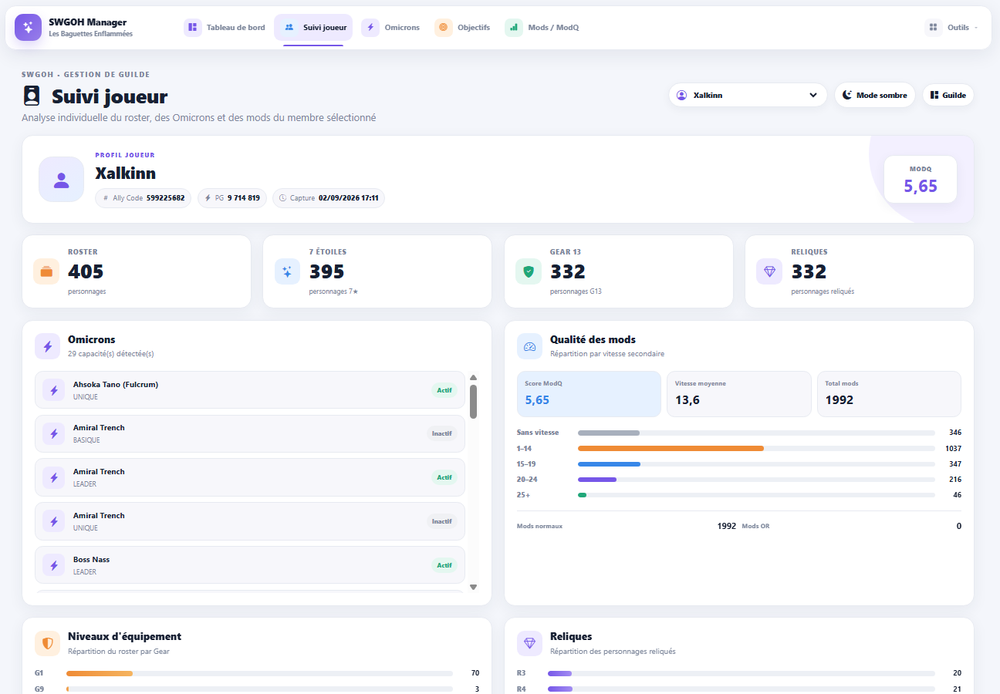

## Suivi joueur

### Recherche simple

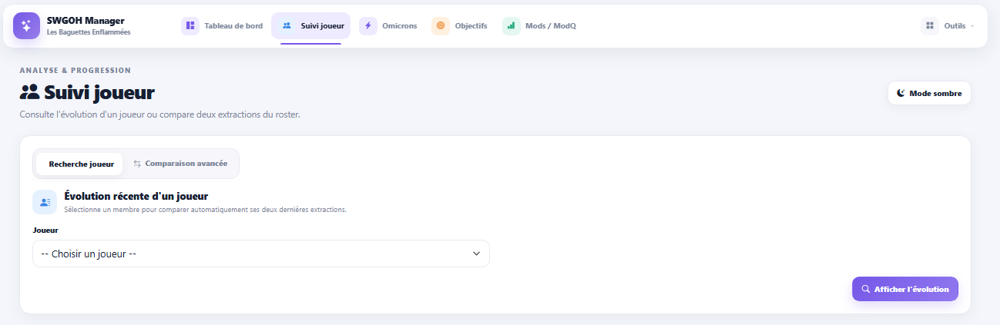

### Recherche avancée

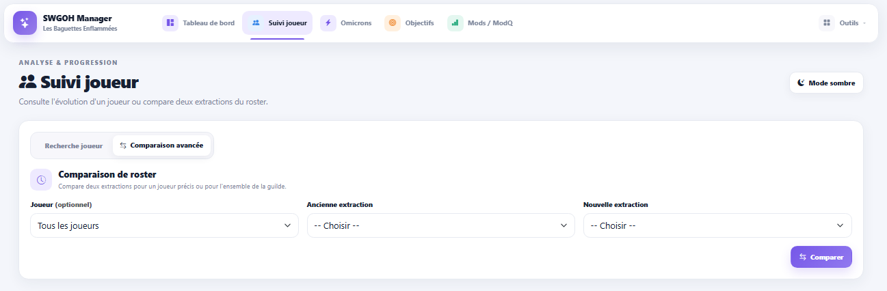

## Omicrons

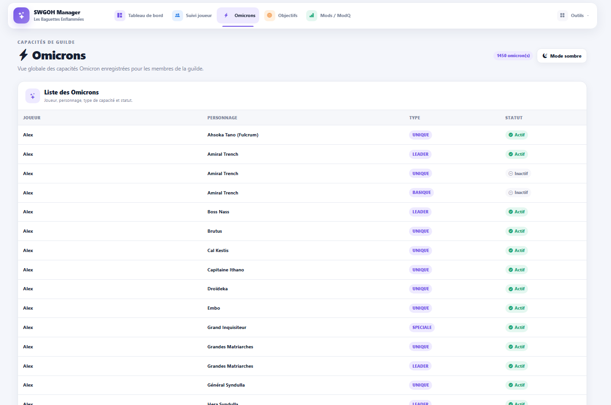

## Objectifs de guilde

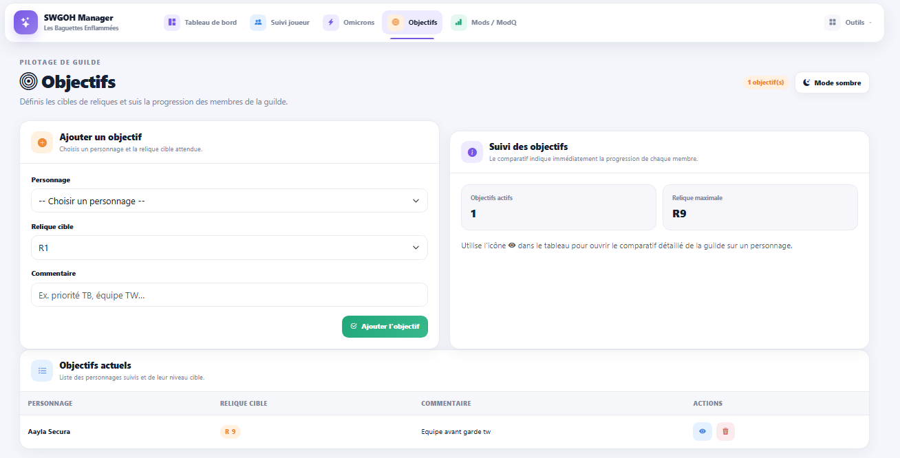

## ModQ

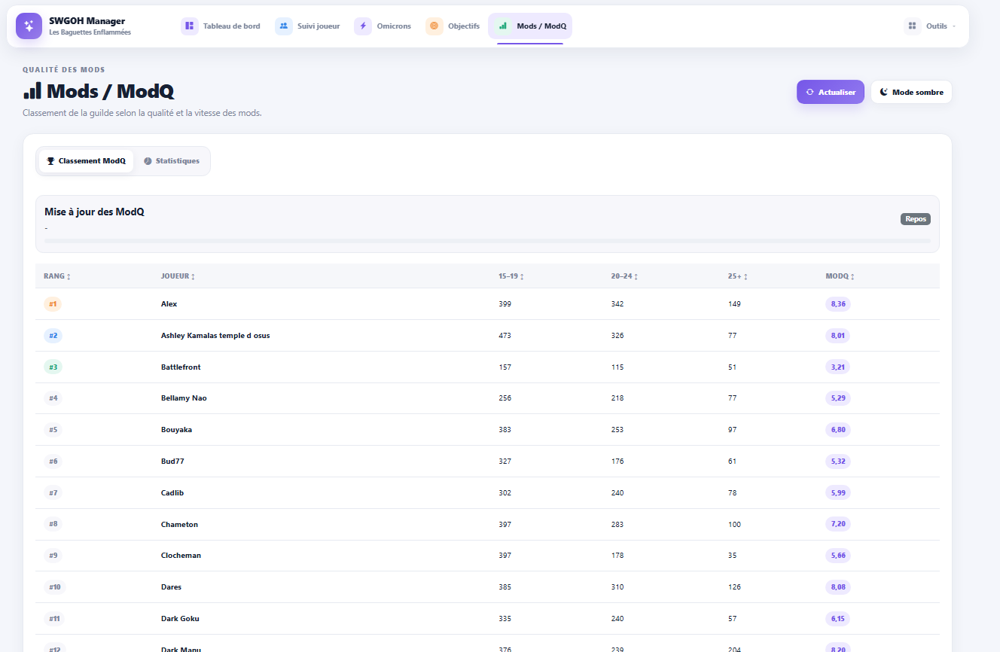

## Mode sombre

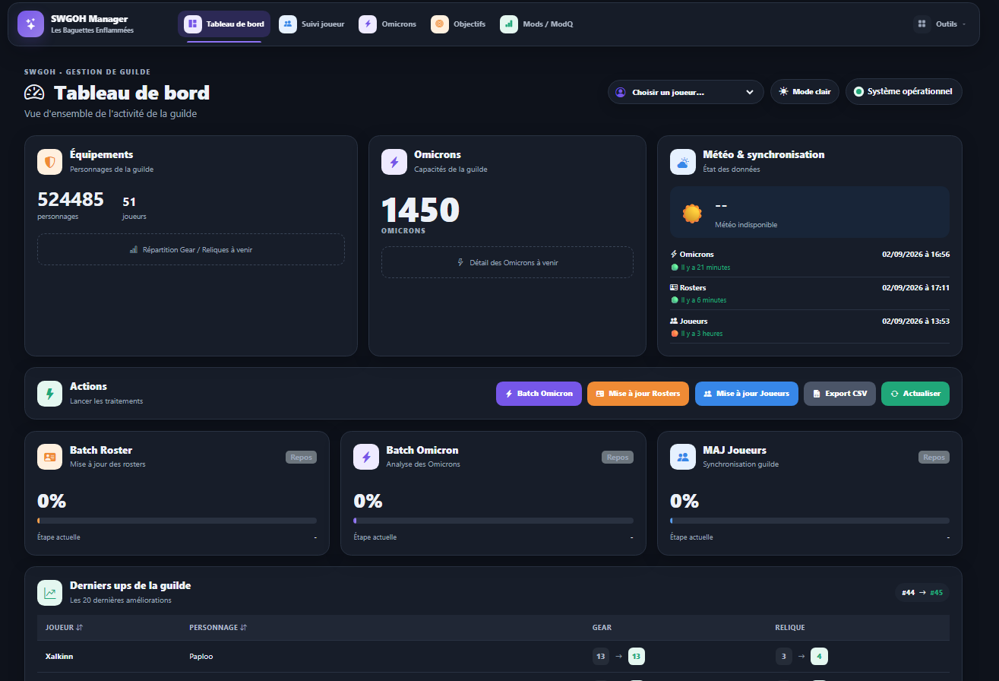

---

# 🏗️ Architecture

Le projet suit une architecture Spring MVC avec séparation entre affichage, logique métier, clients externes et persistance.

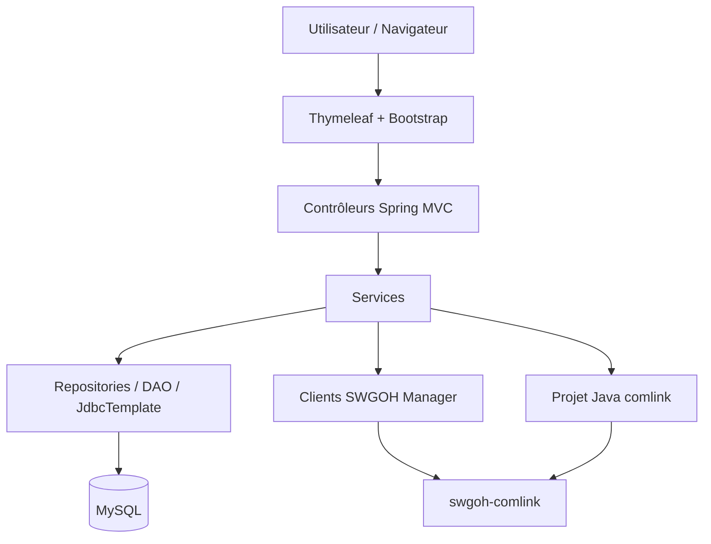

### Clients directs

SWGOH Manager possède plusieurs clients dédiés :

```text
SwgohPlayerClient
SwgohGuildClient
SwgohGameDataClient
SwgohLocalizationClient
```

Ils sont notamment utilisés pour :

- setup par Ally Code ;
- analyse de candidat ;
- historique TB/TW ;
- catalogue Omicron ;
- localisation française.

Le projet Java `comlink` reste utilisé par certains traitements historiques, notamment l'import de roster et une partie de la synchronisation de guilde.

### Responsabilités

| Couche | Rôle |
|---|---|
| `controleur` | Routes HTTP et modèles Thymeleaf |
| `service` | Logique métier, batchs, calculs et agrégations |
| `client` | Appels directs à swgoh-comlink |
| `repository` | Accès Spring Data JDBC |
| `dao` | Accès SQL/JDBC historique |
| `modele` | Entités métier |
| `dto` | Données spécifiques aux vues |
| `templates` | Pages Thymeleaf |
| `static/css` | Design |
| `static/js` | Interactions navigateur |

---

# 🔁 Cycle des données

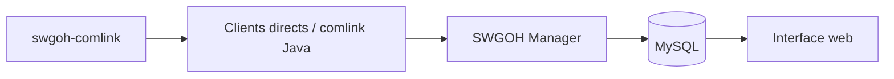

## Exemple : Batch Roster

1. SWGOH Manager récupère les joueurs actifs de la guilde.
2. Le traitement interroge les données SWGOH.
3. Une nouvelle extraction est créée.
4. Les personnages de chaque joueur sont enregistrés.
5. Les anciennes extractions restent en base.
6. Les dashboards utilisent la dernière extraction.
7. Les pages de suivi peuvent comparer deux extractions.

## Exemple : Omicrons

1. `/metadata` fournit la dernière version Game Data.
2. Les segments `skill` et `units` sont analysés.
3. Les capacités Omicron sont enregistrées dans `omicron_definition`.
4. Les officiers configurent P1-P4 dans `omicron_priorite`.
5. Le roster `/player` détermine les Omicrons réellement appliqués.
6. Les dashboards, l'analyse candidat, la TW et les exports réutilisent le même référentiel.

---

# 🇫🇷 Traductions françaises

SWGOH utilise des identifiants techniques tels que :

```text
AHSOKATANO
DARTHVADER
PADAWANSABINE
```

ou :

```text
AHSOKATANO:SEVEN_STAR
```

SWGOH Manager conserve ces identifiants techniques mais affiche le **nom français** lorsque la localisation officielle est disponible.

## Fonctionnement

Le client `SwgohLocalizationClient` interroge :

```text
POST /metadata
```

pour récupérer :

```text
latestLocalizationBundleVersion
```

puis :

```text
POST /localization
```

avec :

```text
<version>:FRE_FR
```

Le bundle est transformé en dictionnaire de traductions.

Les personnages utilisent notamment les clés :

```text
UNIT_<baseId>_NAME
```

Exemple :

```text
UNIT_DARTHVADER_NAME
→ Dark Vador
```

## Table `personnage_definition`

Les traductions sont persistées dans un référentiel dédié :

```text
personnage_definition
```

Cela évite de dupliquer le nom français dans chaque extraction du roster.

Le suffixe technique après `:` est ignoré lors des correspondances :

```text
AHSOKATANO:SEVEN_STAR
        ↓
AHSOKATANO
```

Certaines unités ambiguës disposent d'un libellé d'affichage ciblé afin de distinguer plusieurs versions partageant un nom proche.

---

# 🗄️ Base de données

## Principales tables

| Table | Utilité |
|---|---|
| `guilde` | Guilde active de l'installation |
| `joueur` | Membres et état `dans_guilde` |
| `extraction` | Historique des captures roster |
| `personnage` | Roster historisé par extraction |
| `personnage_definition` | Référentiel des personnages et noms français |
| `mods` | Mods des joueurs |
| `omicron` | Omicrons réellement détectés chez les joueurs |
| `omicron_definition` | Catalogue dynamique Game Data |
| `omicron_priorite` | Plan de guilde P1-P4 |
| `objectif_personnage` | Objectifs personnages |
| `territory_battle` | Historique des TB |
| `tb_activite` | Statistiques TB / `mapStatId` |
| `tb_score_joueur` | Scores TB par joueur et activité |
| `territory_war` | Historique des résultats TW |

## Relations simplifiées

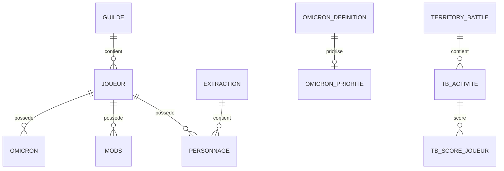

Plusieurs tables modernes sont créées ou adaptées automatiquement au démarrage par leurs services respectifs, notamment :

- `guilde` ;
- tables Omicron dynamiques ;
- tables Territory Battle ;
- `territory_war`.

Des scripts de référence sont également disponibles dans :

```text
src/main/resources/sql/
```

> Le projet ne possède pas encore un `schema.sql` complet couvrant toutes les anciennes tables métier. Une installation totalement vierge nécessite donc encore la structure historique du projet.

---

# 🛠️ Stack technique

| Composant | Technologie |
|---|---|
| Langage | Java 21 |
| Framework | Spring Boot 4.1.0 |
| Web | Spring Web MVC |
| Accès aux données | Spring Data JDBC + JdbcTemplate + DAO historiques |
| Templates | Thymeleaf |
| Front-end | HTML / CSS / JavaScript |
| UI | Bootstrap 5.3 + Bootstrap Icons |
| Base de données | MySQL 8.x |
| Build | Maven / Maven Wrapper |
| Données SWGOH | swgoh-comlink + projet Java `comlink` |
| Localisation | bundle `FRE_FR` via swgoh-comlink |
| Export Omicron | XLSX / ODS natifs + CSV |

---

# 🚀 Installation

## 1. Prérequis

Prévoir :

- **Java 21** ;
- **MySQL 8.x** ;
- **Git** ;
- une instance fonctionnelle de **swgoh-comlink** ;
- le projet Java [`comlink`](https://github.com/Xalkinn/comlink) installé dans le dépôt Maven local ;
- Maven ou le Maven Wrapper fourni.

Configuration de développement courante :

```text
SWGOH Manager : http://localhost:8081
swgoh-comlink : http://localhost:3000
MySQL         : localhost:3333
```

Toutes ces valeurs sont configurables.

## 2. Installer le projet `comlink`

SWGOH Manager référence actuellement :

```xml
<dependency>
    <groupId>swgoh</groupId>
    <artifactId>comlink</artifactId>
    <version>0.0.1-SNAPSHOT</version>
</dependency>
```

Installer le projet dans le dépôt Maven local :

```bash
git clone https://github.com/Xalkinn/comlink.git
cd comlink
./mvnw clean install
```

Sous Windows :

```powershell
mvnw.cmd clean install
```

## 3. Démarrer swgoh-comlink

L'instance doit être accessible depuis SWGOH Manager.

Par défaut :

```text
http://localhost:3000
```

Elle est utilisée pour les joueurs, guildes, Game Data et traductions.

## 4. Préparer MySQL

Créer une base :

```sql
CREATE DATABASE swgoh
CHARACTER SET utf8mb4
COLLATE utf8mb4_0900_ai_ci;
```

Utiliser une collation cohérente pour les colonnes participant aux jointures.

## 5. Cloner SWGOH Manager

```bash
git clone https://github.com/Xalkinn/swgoh-manager.git
cd swgoh-manager
```

## 6. Créer le fichier `.env`

Copier :

```text
.env.example
```

vers :

```text
.env
```

Le fichier `.env` réel ne doit pas être versionné.

---

# ⚙️ Configuration

`application.properties` s'appuie sur des variables d'environnement et charge automatiquement un fichier `.env` local lorsqu'il existe.

Exemple :

```properties
spring.application.name=WebInterfaceSwgoh
spring.config.import=optional:file:.env[.properties]

server.port=${SERVER_PORT:8081}

spring.datasource.url=jdbc:mysql://${DB_HOST:localhost}:${DB_PORT:3306}/${DB_NAME:swgoh}?useSSL=false&allowPublicKeyRetrieval=true&serverTimezone=${APP_TIMEZONE:Europe/Paris}
spring.datasource.username=${DB_USER:swgoh}
spring.datasource.password=${DB_PASSWORD:}

swgoh.comlink.base-url=${COMLINK_URL:http://localhost:3000}
```

Exemple de `.env` :

```dotenv
SERVER_PORT=8081
APP_TIMEZONE=Europe/Paris

DB_HOST=localhost
DB_PORT=3333
DB_NAME=swgoh
DB_USER=root
DB_PASSWORD=root

COMLINK_URL=http://localhost:3000
```

Ordre de priorité utilisé par les anciens composants nécessitant `EnvironmentConfig` :

```text
1. propriété JVM -D...
2. variable d'environnement
3. fichier .env
4. valeur par défaut
```

> Ne versionnez jamais un `.env` contenant des identifiants réels.

---

# ▶️ Premier démarrage

Lancer l'application :

```bash
./mvnw spring-boot:run
```

Sous Windows :

```powershell
mvnw.cmd spring-boot:run
```

Puis ouvrir :

```text
http://localhost:8081
```

Si aucune guilde n'est configurée, l'application redirige automatiquement vers :

```text
/setup
```

## Ordre conseillé

1. Démarrer MySQL.
2. Démarrer `swgoh-comlink`.
3. Vérifier que la dépendance Java `comlink` est installée localement.
4. Démarrer SWGOH Manager.
5. Dans `/setup`, saisir l'Ally Code d'un membre de la guilde.
6. Vérifier la guilde détectée.
7. Lancer la **synchronisation guilde**.
8. Lancer un **Batch Roster**.
9. Actualiser le catalogue / lancer le **Batch Omicron**.
10. Mettre à jour les mods / ModQ.
11. Importer ou vérifier les historiques TB/TW disponibles.

---

# 🧭 Routes principales

| Route | Fonction |
|---|---|
| `/` | Dashboard général |
| `/setup` | Configuration initiale par Ally Code |
| `/admin` | Administration / diagnostic |
| `/dashboard/joueur/{joueurId}` | Dashboard individuel |
| `/joueurs` | Suivi joueur |
| `/objectifs` | Objectifs de guilde |
| `/omicrons` | Catalogue Omicron dynamique + priorités P1-P4 |
| `/omicrons/export?format=excel` | Export Excel |
| `/omicrons/export?format=libreoffice` | Export LibreOffice |
| `/omicrons/export?format=csv` | Export CSV |
| `/modq` | Mods / ModQ |
| `/analyse` | Analyse ponctuelle d'un candidat par Ally Code |
| `/tb` | Historique et détail des Batailles de territoire |
| `/tb/importer` | Import manuel de la dernière TB disponible (`POST`) |
| `/tw` | Historique et préparation des Guerres de territoire |
| `/tw/importer` | Import manuel des dernières TW disponibles (`POST`) |
| `/actions/synchronisation-guilde` | Synchronisation guilde |
| `/actions/batch-roster` | Mise à jour des rosters |
| `/actions/batch-omicron` | Mise à jour des Omicrons |
| `/actions/maj-modq` | Mise à jour ModQ |

Des routes `/api/.../status` sont utilisées par le JavaScript pour suivre les traitements en cours.

---

# 📁 Structure du projet

```text
swgoh-manager/
│
├── .env.example
├── pom.xml
├── mvnw
├── mvnw.cmd
├── README.md
│
└── src/
    └── main/
        ├── java/
        │   └── fr/xalkinn/swgohmanager/
        │       ├── client/
        │       │   ├── SwgohPlayerClient.java
        │       │   ├── SwgohGuildClient.java
        │       │   ├── SwgohGameDataClient.java
        │       │   └── SwgohLocalizationClient.java
        │       ├── config/
        │       ├── controleur/
        │       ├── service/
        │       ├── repository/
        │       ├── dao/
        │       ├── modele/
        │       └── dto/
        │
        └── resources/
            ├── application.properties
            ├── templates/
            │   ├── dashboard.html
            │   ├── dashboard-joueur.html
            │   ├── joueurs.html
            │   ├── objectifs.html
            │   ├── omicrons.html
            │   ├── modq.html
            │   ├── analyse.html
            │   ├── tb.html
            │   ├── tw.html
            │   ├── setup.html
            │   ├── administration.html
            │   └── fragments/
            ├── static/
            │   ├── css/
            │   └── js/
            ├── image/
            └── sql/
```

---

# 🔍 Quelques choix techniques importants

## Les données brutes restent intactes

Les identifiants techniques SWGOH restent stockés tels quels.

Exemple :

```text
AHSOKATANO:SEVEN_STAR
```

Le nom français est un référentiel d'affichage et ne remplace pas la clé technique.

Cela protège :

- les jointures ;
- les historiques ;
- les objectifs ;
- les comparaisons ;
- les imports futurs.

## Les Omicrons utilisent les vrais identifiants Game Data

Le catalogue conserve :

```text
base_id
skill_id
omicron_mode_code
categorie
tier_requis
```

Le `skill_id` identifie précisément une capacité même lorsqu'un personnage possède plusieurs capacités du même type.

## Les TB/TW restent exploitables hors événement

Les analyses TB et TW principales reposent sur les **résultats finaux exposés par Comlink**, pas sur une surveillance continue.

L'application n'a donc pas besoin de rester connectée pendant tout l'événement pour conserver les statistiques actuellement prises en charge.

## Pas de données inventées

Lorsqu'un croisement n'est pas fourni par Comlink — par exemple **planète + round** en TB ou **attaques individuelles** après une TW — l'application préfère afficher une limite claire plutôt que produire une estimation fragile.

---

# 🧪 Dépannage

## La dépendance `swgoh:comlink` est introuvable

Erreur Maven typique :

```text
Could not find artifact swgoh:comlink:jar:0.0.1-SNAPSHOT
```

Réinstaller le projet `comlink` :

```bash
cd comlink
./mvnw clean install
```

## L'application redirige toujours vers `/setup`

Vérifier que la table `guilde` contient une ligne active :

```sql
SELECT *
FROM guilde
WHERE active = TRUE;
```

Si aucune guilde n'est active, saisir à nouveau un Ally Code valide dans `/setup`.

## swgoh-comlink ne répond pas

Vérifier `COMLINK_URL` dans `.env`.

Exemple :

```dotenv
COMLINK_URL=http://localhost:3000
```

La page `/admin` permet également de tester la connexion.

## Les traductions françaises ne se chargent pas

Vérifier que le serveur swgoh-comlink configuré répond correctement et expose `/metadata` et `/localization`.

Si aucune traduction n'est disponible, le nom brut est utilisé comme fallback.

## Un nom de personnage reste brut

Contrôler le référentiel :

```sql
SELECT
    base_id,
    nom_brut,
    nom_francais,
    cle_localisation
FROM personnage_definition
WHERE base_id = 'BASE_ID_DU_PERSONNAGE';
```

## `Illegal mix of collations`

Les colonnes utilisées dans une jointure doivent avoir des collations compatibles.

Conserver autant que possible une configuration `utf8mb4` cohérente sur l'ensemble de la base.

## Les Omicrons attendus n'apparaissent pas

Vérifier successivement :

1. **Actualiser le catalogue** dans `/omicrons` ;
2. vérifier la version Game Data ;
3. lancer **Actualiser les joueurs** ;
4. contrôler que la définition est active dans `omicron_definition` ;
5. vérifier le `skill_id` et le `tier_requis`.

---

# 🗺️ Roadmap

## ✅ Implémenté

- [x] Dashboard général moderne
- [x] Dashboard individuel joueur
- [x] Suivi joueur et comparaison d'extractions
- [x] Historique des upgrades
- [x] Objectifs de guilde
- [x] Localisation française des personnages
- [x] Référentiel `personnage_definition`
- [x] Mods et ModQ
- [x] Catalogue Omicron dynamique Game Data
- [x] Catégories TW / TB / Grande Arène / Raid / Conquête
- [x] Priorités Omicron P1-P4
- [x] Exports Omicron XLSX / ODS / CSV
- [x] Onglets P1-P4 dans les exports tableur
- [x] Popins Omicrons manquants sur dashboard joueur
- [x] Analyse candidat par Ally Code sans persistance
- [x] Comparaison candidat ↔ moyenne/médiane guilde
- [x] Plan Omicron du candidat
- [x] Performances TB récentes du candidat
- [x] Détail des missions spéciales du candidat
- [x] Historique Batailles de territoire
- [x] Vue TB fiable par jours / rounds
- [x] Vue TB par planètes en cumul
- [x] Détail TB par joueur
- [x] Missions spéciales TB réussies / échecs / non tentées
- [x] Historique Guerres de territoire
- [x] Statistiques globales TW
- [x] Préparation TW roster / mods / Omicrons
- [x] Popin des Omicrons TW manquants
- [x] Setup initial par Ally Code
- [x] Configuration `.env`
- [x] Page Administration
- [x] Mode sombre

## 🚧 À poursuivre

- [ ] Analyse d'adversaire TW via `territoryWarStatus`
- [ ] Ajouter des portraits de personnages
- [ ] Ajouter des filtres avancés au roster joueur
- [ ] Ajouter davantage de graphiques historiques
- [ ] Ajouter une comparaison dashboard joueur ↔ moyenne/médiane de guilde
- [ ] Ajouter un `schema.sql` complet pour installation vierge
- [ ] Ajouter Docker Compose pour le self-hosting
- [ ] Ajouter des tests automatisés
- [ ] Ajouter une authentification et des rôles **ADMIN / OFFICIER / LECTURE**
- [ ] Étudier une véritable architecture multi-guildes

---

# 🔗 Projet lié

## `comlink`

Repository :

```text
https://github.com/Xalkinn/comlink
```

Le projet Java `comlink` reste utilisé par SWGOH Manager pour certains traitements historiques de récupération et d'import.

SWGOH Manager prend ensuite en charge :

- persistance ;
- historisation ;
- analyse ;
- statistiques ;
- priorités de guilde ;
- restitution web.

---

# 🤝 Contribution

Pour proposer une évolution :

1. créer une branche ;
2. développer la fonctionnalité ;
3. tester les batchs et pages concernées ;
4. vérifier le rendu clair/sombre ;
5. ouvrir une Pull Request.

Convention recommandée :

```text
feature/nom-fonctionnalite
fix/nom-correction
refactor/nom-refactor
```

---

# ⚠️ Avertissement

Ce projet est un outil communautaire non officiel.

Il n'est pas affilié à Electronic Arts, Capital Games, Lucasfilm ou Disney.

Les noms et éléments relatifs à *Star Wars: Galaxy of Heroes* appartiennent à leurs propriétaires respectifs.

---

# 📝 Licence

Aucune licence spécifique n'est actuellement déclarée dans le projet.

Si le dépôt devient public ou accueille des contributions externes, il est recommandé d'ajouter explicitement un fichier `LICENSE`.
